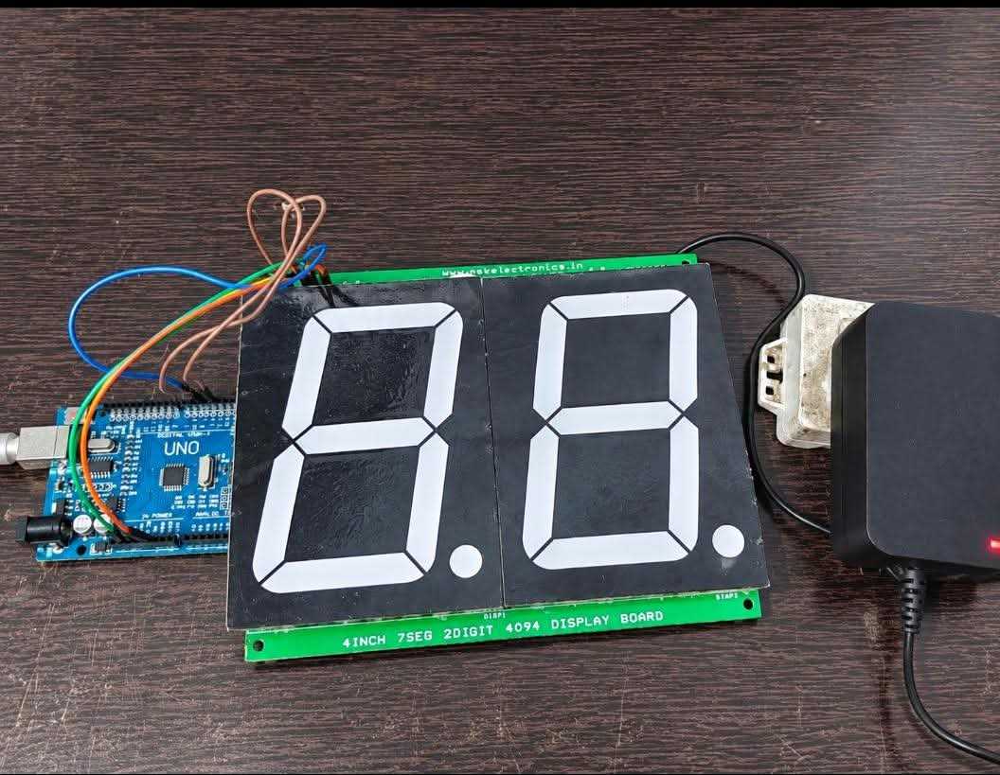

# Arduino 2-Digit 7-Segment Display Counter (00–99)

## Project Overview

This project demonstrates the interfacing of an Arduino UNO with a 4-inch, 2-digit 7-segment display board using a 4094 shift register. The system displays numerical values sequentially from **00 to 99** with an interval of 500 milliseconds between each number.

The Arduino communicates with the display board through three digital signals: DATA, CLOCK, and STROBE. The 4094 shift register helps transfer display data using fewer Arduino GPIO pins.

This project provides practical experience in digital electronics, microcontroller interfacing, shift register communication, and hardware implementation.

## Project Objectives

- Interface a large 2-digit 7-segment display with Arduino UNO.
- Understand the working principle of the 4094 shift register.
- Generate and display numerical values from 00 to 99.
- Implement serial data transmission using DATA, CLOCK, and STROBE signals.
- Understand digital output control and segment encoding.
- Develop practical experience in hardware interfacing and testing.

## Hardware Components Required

| Component | Quantity | Purpose |
|---|---:|---|
| Arduino UNO | 1 | Main microcontroller |
| 4-inch 2-Digit 7-Segment Display Board | 1 | Numerical display |
| 4094 Shift Register Board | 1 | Serial-to-parallel data transfer |
| 12V DC Adapter | 1 | Power supply for the display board |
| Jumper Wires | As required | Electrical connections |

## Software Requirements

- Arduino IDE
- Arduino C/C++ programming
- USB cable for Arduino programming

## Hardware Connections

The Arduino UNO communicates with the 4094 display board through three digital pins.

| Arduino UNO Pin | Display Board Signal |
|---|---|
| Digital Pin 2 | DATA |
| Digital Pin 3 | CLOCK (CLK) |
| Digital Pin 4 | STROBE (STRB) |

**Power Supply:**
- Arduino UNO is powered through its USB connection during programming and testing.
- A 12V DC adapter is used for the display board according to its power input specification.
- Ensure the required common ground and correct power connections as specified by the board.

**Important:** Do not connect the 12V supply directly to the Arduino 5V pin.

## Working Principle

The project works based on serial data communication between the Arduino UNO and the 4094 shift register-based 7-segment display board.

### 1. Arduino Initialization

During the setup process, the Arduino configures three digital pins:

- Pin 2 as DATA output.
- Pin 3 as CLOCK output.
- Pin 4 as STROBE output.

These pins are used to transmit the numerical data to the display board.

### 2. Seven-Segment Digit Encoding

A 7-segment display consists of seven individual LED segments named A, B, C, D, E, F, and G. An additional decimal point segment (DP) is also available.

The program uses predefined binary patterns to represent decimal digits from 0 to 9.

Each binary pattern determines which LED segments should turn ON or OFF to display the corresponding number.

### 3. 4094 Shift Register Communication

The Arduino uses the `shiftOut()` function to transmit 8-bit display data serially.

The communication involves three signals:

- **DATA:** Carries the binary information.
- **CLOCK:** Synchronizes the transfer of individual bits.
- **STROBE:** Controls the transfer of shifted data to the output stage.

The program sends the ones digit first, followed by the tens digit, using MSBFIRST data transmission.

### 4. Number Generation

The `showNumber()` function separates a given number into two individual digits.

- Tens digit = Number / 10
- Ones digit = Number % 10

For example, if the number is 45:
- Tens digit = 4
- Ones digit = 5

The corresponding segment patterns are transmitted to the display board.

### 5. Automatic Counting

Inside the `loop()` function, a `for` loop generates numbers from 0 to 99.

The display updates every 500 milliseconds using `delay(500)`.

After displaying 99, the counter automatically starts again from 00.

## Program Implementation

**Program File:** `Arduino_2Digit_7Segment_Counter.ino`

The program uses the following important functions:

| Function | Description |
|---|---|
| `setup()` | Configures Arduino output pins |
| `send2()` | Sends two digit patterns to the display |
| `showNumber()` | Converts a number into tens and ones digits |
| `shiftOut()` | Transfers binary data serially |
| `loop()` | Continuously counts from 00 to 99 |

### Important Configuration

```cpp
const int dataPin = 2;
const int clockPin = 3;
const int strobePin = 4;

const bool INVERT = false;
```

The `INVERT` setting controls the display logic. It is set to `false` in this implementation.

## Hardware Implementation

The hardware was assembled using an Arduino UNO, a 4-inch 2-digit 7-segment display board, jumper wires, and a 12V DC adapter.

The Arduino was programmed to transmit the required binary patterns to the display board through the 4094 shift register interface.

The complete hardware setup was tested to verify the display operation and automatic counting sequence.

### Hardware Setup



## Demonstration Video

The demonstration video shows the actual hardware operation, including the automatic numerical counting sequence from 00 to 99.

**Video:** Add your demonstration video to the repository and update the filename below.

[Watch the 7-Segment Display Demonstration](https://drive.google.com/file/d/1CVTv6hFq_R2Tu4-i-jy44O5PZ4updLy9/view?usp=drivesdk)

## Expected Output

The display continuously shows the following numerical sequence:

```text
00 → 01 → 02 → 03 → 04
05 → 06 → 07 → 08 → 09
10 → 11 → 12 → 13 → 14
...
90 → 91 → 92 → 93 → 94
95 → 96 → 97 → 98 → 99
```

After reaching 99, the display restarts from 00.

**Counting Interval:** 500 milliseconds

**Display Format:** Two-digit decimal numbers

## Key Learnings

Through this project, I gained practical knowledge and experience in:

- Arduino UNO programming and digital output control.
- Interfacing a large 7-segment display with a microcontroller.
- Understanding the 4094 shift register and its operation.
- Serial data transmission using DATA, CLOCK, and STROBE signals.
- Understanding binary representation of decimal digits.
- Seven-segment display encoding and segment control.
- Using the `shiftOut()` function in Arduino programming.
- Converting decimal numbers into individual display digits.
- Hardware connections, power supply considerations, and testing.
- Integrating software and electronic hardware components.

## Applications

The concepts demonstrated in this project can be applied to:

- Digital counters.
- Industrial numerical displays.
- Production and process monitoring systems.
- Digital scoreboards.
- Electronic counting systems.
- Large-format numerical display applications.

## Future Enhancements

The project can be further improved by implementing:

1. **Push Button Control:** Add buttons to manually increment and decrement the displayed numbers.
2. **Reset Function:** Provide a dedicated button to reset the counter to 00.
3. **Adjustable Counting Speed:** Allow users to control the counting interval.
4. **Up and Down Counter:** Implement both forward and reverse counting operations.
5. **Sensor-Based Counting:** Integrate IR or proximity sensors to count objects automatically.
6. **Real-Time Clock Integration:** Display time using an RTC module.
7. **Multiple Display Expansion:** Extend the system to support additional 7-segment digits.
8. **Wireless Control:** Add Bluetooth communication to control the display remotely.

## Conclusion

This project successfully demonstrates the interfacing of an Arduino UNO with a 24-inch, 2-digit 7-segment display using a 4094 shift register board.

The system automatically displays numerical values from 00 to 99 with a 500-millisecond delay between updates.

Through this implementation, I gained hands-on experience in microcontroller programming, shift register communication, digital electronics, and hardware-software integration.

